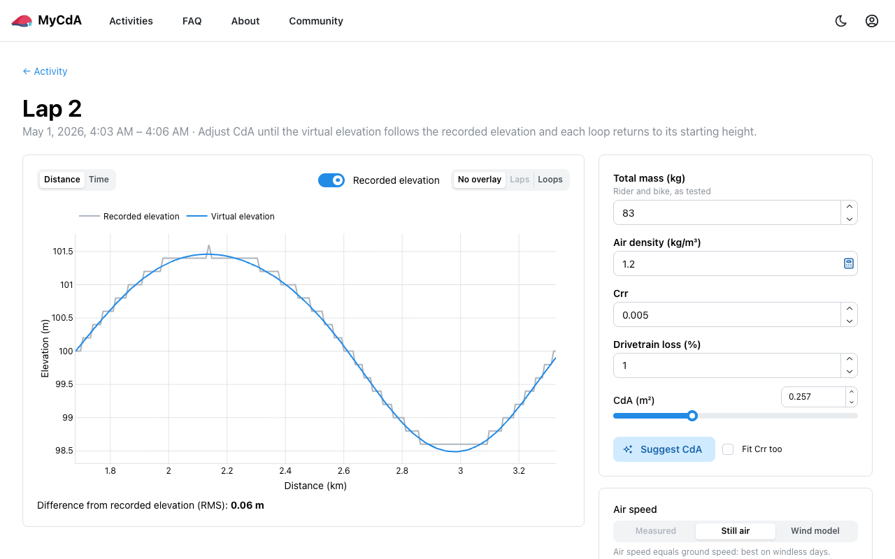
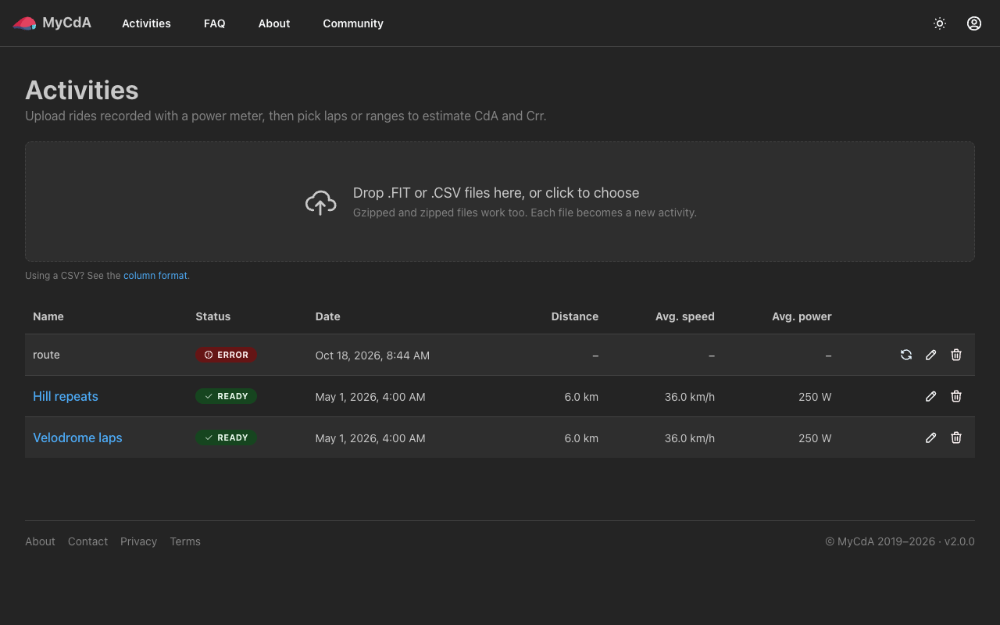
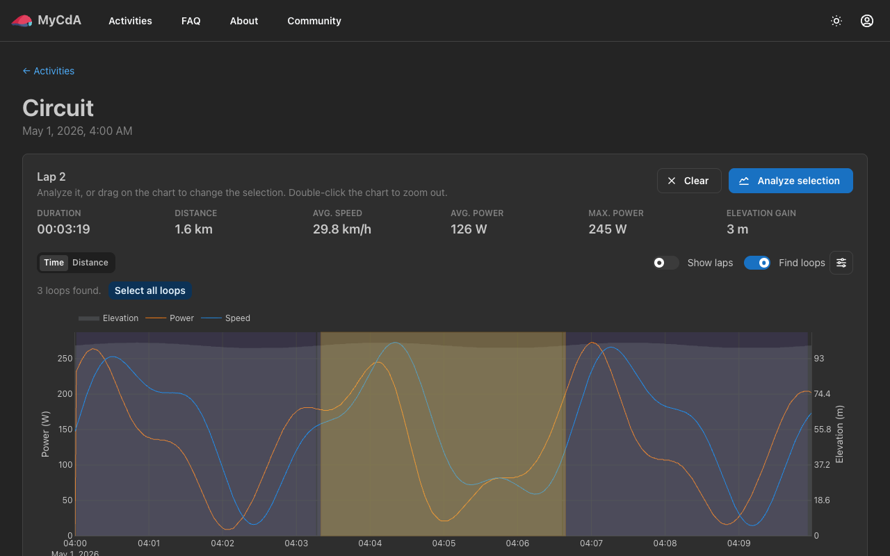

# MyCdA.app

MyCdA.app estimates your aerodynamic drag area (CdA) and rolling resistance (Crr) from rides recorded with a power meter, speed sensor and cycling computer. Compare runs to find out whether a change in position or equipment makes you faster.

**Try it: [mycda.app](https://mycda.app)** (free)



## Features

- **Upload** Garmin `.fit` and `.csv` files, including gzipped and zipped exports. Problem files say exactly why they can't be used, and failed or interrupted uploads can be retried.
- **Explore** power, speed and elevation over time or distance, with laps, automatic loop detection and an OpenStreetMap view of the track.
- **Analyze** any lap, set of loops or range with R. Chung's [virtual elevation method](http://anonymous.coward.free.fr/wattage/cda/indirect-cda.pdf). Tune CdA and Crr by hand, or let **Suggest CdA** fit them to the recorded elevation or to loop closure.
- **Air speed**: use an air speed sensor (via CSV), still air, or a wind model built from hourly weather for the time and place of your ride.
- **Air density** from temperature, dew point, pressure and altitude, looked up from historical weather ([Open-Meteo](https://open-meteo.com/)). It's also a [standalone calculator](https://mycda.app/rho).
- **Compare** saved analyses against a baseline in watts saved and seconds per 40 km, with the mean, standard deviation and coefficient of variation of CdA.
- Metric or imperial units, light and dark themes, and phone-friendly layouts.

| Activities | Activity |
|---|---|
|  |  |

## How it works

| Part | Technology |
|---|---|
| Web app (`web/`) | React 19, TypeScript, Vite, Mantine, React Router, TanStack Query, Plotly, Leaflet |
| Analysis core (`web/src/core/`) | Framework-free TypeScript: virtual elevation, fitting, wind model, air density, loop detection |
| Backend | Firebase Auth, Firestore, Storage and Hosting. Cloud Functions (`functions/`, Node 22) parse uploads and serve activity data |
| External data | Open-Meteo (weather, elevation) and OpenStreetMap (maps), with no API keys |

Architecture, design notes and decision records are in [`docs/`](docs/README.md).

## Development

You need Node 22+ and, for the emulator tests, Java 21+ and Chrome.

```bash
# web app
cd web
npm ci
cp .env.example .env.local     # fill in your Firebase web config
npm run dev                    # http://localhost:5173

# or run everything locally against the Firebase emulators
npm --prefix ../tests/emulator ci
npm --prefix ../tests/emulator run emulators   # terminal 1
npm run dev:emulators                          # terminal 2
```

Tests:

```bash
npm --prefix web test               # analysis core, data and UI helpers (Vitest)
npm --prefix functions test         # upload parsing (node --test)
npm --prefix tests/emulator test    # security rules, functions end to end, browser tests (Playwright)
```

CI runs all of them on every push (`.github/workflows/ci.yml`).

### Setting up your own instance

1. Create a Firebase project on the Blaze plan. Enable Email/Password sign-in, Firestore and Storage.
2. Point `.firebaserc` at your project, and fill in `web/.env.local` from the project's web app config.
3. Deploy with `firebase deploy`. That deploys the Firestore and Storage rules, the functions, and hosting (which builds `web/` first).

## CSV format

The header row needs `time`, `power` and `speed` (km/h). It can also have `airspeed`, `elevation`, `lap`, `lat` and `long`. See the [FAQ](https://mycda.app/faq#csv) for details, or download the [example file](web/public/mycda-example.csv).

## Community

Questions and release notes: the [MyCdA community](https://groups.google.com/forum/#!forum/mycda). Bugs and ideas: [GitHub issues](https://github.com/mariuspopovici/mycda.app/issues).

## License

[MIT](LICENSE)
