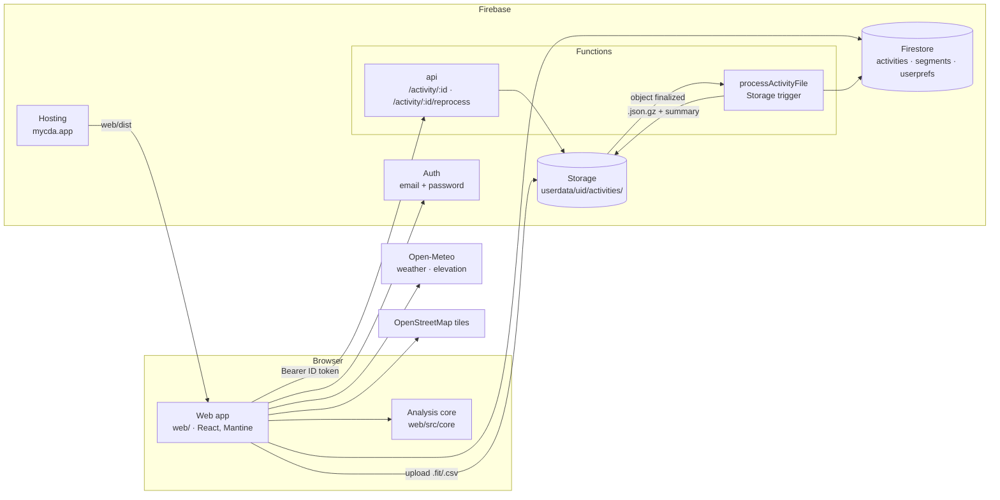
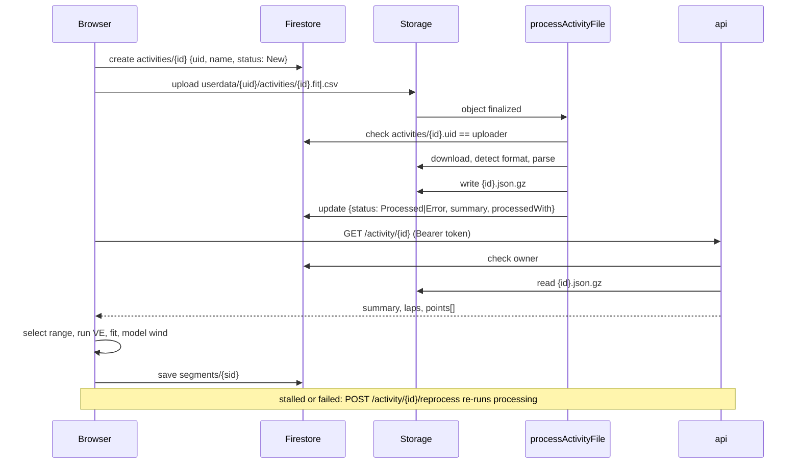

# System overview

MyCdA.app estimates a cyclist's aerodynamic drag area (CdA) and rolling resistance (Crr) from power, speed and elevation data, using R. Chung's virtual elevation (VE) method.

1. Riders upload Garmin `.fit` or `.csv` files and pick a lap or a range.
2. They tune CdA and Crr until the virtual elevation profile matches reality, or let the app suggest values.
3. They save the result as a *segment* and compare segments against a baseline.

The React app replaced the 2017 Vue app on 2026-10-18. The data model is unchanged, so years of existing user data work as before. The migration is recorded in [plans/modernization.md](../plans/modernization.md).

## Components

| Component | Location | Role |
|---|---|---|
| Web app | `web/` | React 19, Vite, TypeScript, Mantine 9, React Router 8, TanStack Query, Firebase 12 modular SDK. Served by Firebase Hosting from `web/dist`, with the public pages prerendered ([seo.md](seo.md)) |
| Analysis core | `web/src/core/` | Framework-free TypeScript: VE, CdA/Crr fitting, range stats, wind model, weather sampling, air density, loop finder, spike filter, segment stats, units |
| `processActivityFile` | `functions/index.js` | 2nd-gen Storage trigger, `us-central1`. Checks ownership, parses the upload, stores `<id>.json.gz` next to it, and records status, summary and `processedWith` |
| `api` | `functions/index.js` | 2nd-gen HTTPS function: an Express app behind Firebase ID-token auth. `GET /activity/:id` returns parsed points; `POST /activity/:id/reprocess` re-runs processing |
| File parsing | `functions/activity.js`, `functions/csv.js` | Firebase-free parsing (`parseActivityFile`, `validateFileContents`, `getActivityData`), also imported by the web tests |
| External services | Open-Meteo, OpenStreetMap | Called from the browser. No API keys (ADR-0004, ADR-0005) |

## Activity lifecycle

## Related

- [data-model.md](data-model.md): collections, storage layout, payload shapes and units
- [security.md](security.md): auth, rules, function access control
- [../design/](../design/): the analysis algorithms and testing
