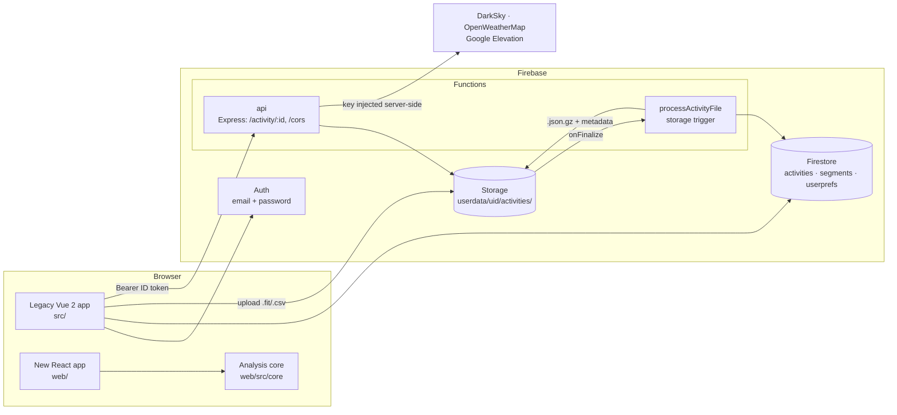
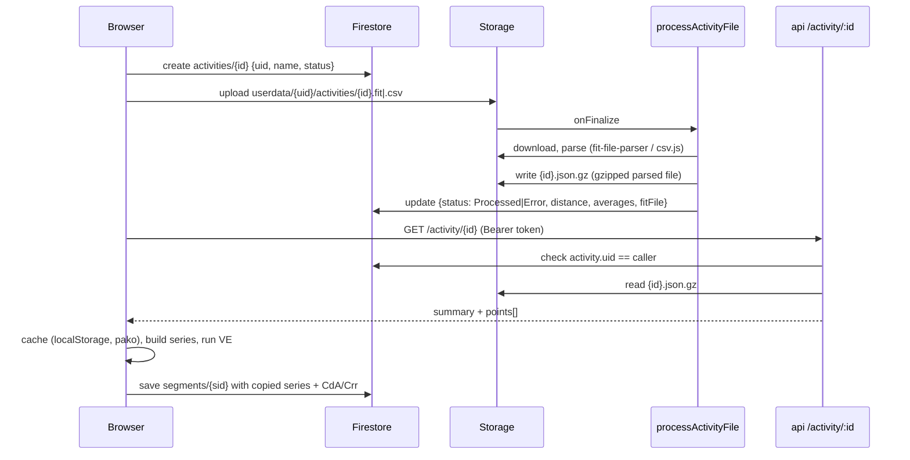

# System overview

MyCdA.app estimates a cyclist's aerodynamic drag area (CdA) and rolling resistance (Crr) from power, speed and elevation data, using R. Chung's virtual elevation (VE) method. Riders upload Garmin `.fit` or `.csv` files, pick a lap or chart range, tune CdA and Crr until the virtual elevation profile matches reality, save the result as a *segment*, and compare segments against a baseline.

The system is mid-migration from a Vue 2 app to a React app (see [plans/modernization.md](../plans/modernization.md)). Both share the same Firebase backend and data.

## Components

| Component | Location | Role |
|---|---|---|
| Legacy web app | `src/` | Vue 2, bootstrap-vue, Vuex, plotly, Google Maps. Still in production; to be deleted at cutover |
| New web app | `web/` | React 19, Vite, TypeScript. It contains only the analysis core so far |
| Analysis core | `web/src/core/` | Framework-free TypeScript: VE, wind model, loop finder, spike filter, segment stats, units, weather sampling |
| `processActivityFile` | `functions/index.js` | Runs on upload: parses the file, stores `<id>.json.gz` next to it, updates the activity status and summary |
| `api` | `functions/index.js` | Express app behind Firebase ID-token auth. `/activity/:id` returns parsed points; `/cors` proxies keyed third-party APIs |
| File parsing | `functions/activity.js`, `functions/csv.js` | Firebase-free parsing (`parseFIT`, `parseCSV`, `validateFileContents`, `getActivityData`), importable by tests |

## Activity lifecycle

## Target state

After the migration (see [ADR-0002](../decisions/0002-rewrite-frontend-in-react.md) to [ADR-0005](../decisions/0005-open-meteo-for-weather-and-elevation.md)):

- `web/` replaces `src/`: React, Mantine, Leaflet with OpenStreetMap tiles, the modular Firebase SDK, TanStack Query.
- Weather and elevation come from Open-Meteo directly from the browser. No API keys, so the `/cors` proxy is deleted.
- Functions move to 2nd gen (Node 22), secrets move to Secret Manager, and `node-fetch`, `node-gzip` and `mkdirp` are replaced with built-ins.
- Firebase Hosting serves the Vite build output.
- Firestore collections and Storage paths stay unchanged, so existing user data needs no migration.

## Related

- [data-model.md](data-model.md): collections, storage layout, payload shapes and units
- [security.md](security.md): auth, rules, function access control
- [../design/](../design/): the analysis algorithms
