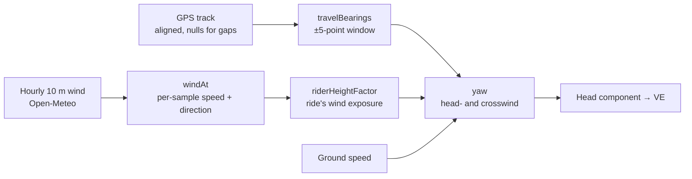

# Wind model

Implementation: `web/src/core/windModel.ts`, `web/src/core/weather.ts`.

Without an air speed sensor, VE uses ground speed as air speed, which is only right in still air. The wind model estimates air speed from the GPS track and weather data instead.

## Pipeline



The pages call `useAirspeed()` (`web/src/pages/analysis/useWindModel.ts`), which does the scaling for both weather and manual winds.

## Direction of travel

`travelBearings(track)` computes, for each sample *i*, the initial great-circle bearing between the first fix at or after *i−5* and the last fix at or before *i+5*.

- Missing fixes (`null`) are skipped, but indexes stay aligned with the other series.
- Samples with no usable bearing (no fixes nearby, or standing still on one coordinate) take the nearest known bearing.
- If the whole track has no usable bearing, the result is `undefined`, `windModelAirSpeed` throws, and the UI must not offer the wind model.

The legacy model re-evaluated the bearing every 10 points from the *previous* chunk, so it lagged corners by up to 10 s. It also dropped missing fixes, which shifted every later position against speed and time on partial-GPS rides.

## Air speed and yaw

`yaw(groundSpeed, windSpeed, relativeAngle)` splits the wind into components along and across the direction of travel:

```
relative angle θ = windDirection − bearing      (meteorological: where the wind comes FROM)
headwind = |v_ground| + v_wind·cos θ            → airspeed (signed)
sidewind = v_wind·sin θ
apparent = √(headwind² + sidewind²)
yaw = atan2(sidewind, headwind)
```

Riding north (bearing 0°) into a north wind (direction 0°) gives θ = 0, a pure headwind, so air speed is ground speed plus wind speed.

VE uses the **head component** as air speed (ADR-0014), following Martin et al. (1998): the force opposing motion is along the direction of travel, and the effect of yaw belongs in CdA. Using the apparent magnitude would overstate drag by about 1/cos(yaw). The head component is negative when a tailwind is faster than the rider, and VE's `v_air·|v_air|` term then counts it as a push. `apparent` and `yaw` are returned for display only.

## Wind at rider height

Weather models and stations report wind at 10 m. Near the ground, wind follows the logarithmic profile u(z) ∝ ln(z / z₀), where z₀ is the roughness length of the surroundings. `riderHeightFactor(exposure)` scales the 10 m wind to 1 m:

| Exposure | z₀ | Factor | Course |
|---|---|---|---|
| `open` | 0.03 m | 0.60 | fields, seafront |
| `mixed` (default) | 0.1 m | 0.50 | hedges, scattered trees |
| `sheltered` | 0.2 m | 0.41 | suburbs, woods |

The exposure is a ride setting (`analysisDefaults.windExposure`), so every analysis and test of a ride uses the same one. Saved analyses record theirs. Manual winds are scaled too, unless marked *measured at rider height*. The exposure is never fitted: a closure can't separate a wind scale from CdA.

Why it matters: on an out-and-back, drag per distance goes as 2(v² + w²). At 36 km/h with 15 km/h at 10 m and 8 km/h at the rider, using the 10 m wind fits CdA about 11 % low.

## Sampling hourly weather

`windAt(hourly, timestamps)` samples hourly observations at each ride timestamp **by absolute time**, using epoch milliseconds. The result therefore doesn't depend on the browser's or the ride location's time zone. The legacy app indexed hourly data with `date.getHours()`, which is the browser's local hour.

- Speed is interpolated linearly.
- Direction is interpolated along the shorter arc (350° → 10° passes through 0°, not 180°).
- Timestamps outside the data take the nearest observation.

Wind speed must be in the same unit as ground speed (km/h).

## Fetching weather

`fetchHourlyWeather()` in `web/src/services/openMeteo.ts` requests UTC hourly temperature, dew point, sea-level pressure and 10 m wind (km/h) for the ride's days:
- from the forecast API for rides in the last 90 days (high-resolution models, filled in within hours);
- from the reanalysis archive for older rides.

Hours that aren't filled in yet are dropped. `fetchElevation()` returns terrain elevation for rides without altitude data.

Air density (`web/src/core/airDensity.ts`, a port of `@mariuspopovici/rho`) adjusts sea-level pressure to the ride's altitude with the barometric formula, then sums the dry-air and water-vapour partial densities. It uses sea-level pressure plus the ride's own altitude, rather than Open-Meteo's surface pressure, because the model grid cell's elevation can differ from the road's.

## Limitations

- Reanalysis wind is a gridded 10 m value. The exposure classes are a coarse correction to rider height: local shelter from a single hedge, cutting or building can differ a lot. Treat wind-model CdA as indicative, and prefer measured air speed or still days.
- Wind is fetched for the first GPS fix only, which suits test-length rides better than long point-to-point ones.
- No gust or turbulence modelling.
