# MyCdA.app roadmap

As of 2026-10-18. The working copy for discussion and comments is the [shared roadmap doc](https://claude.ai/code/artifact/96be89f0-3c65-4ae3-b8d2-3ce4a666f9d4); update this file when the plan changes.

## Where we are

MyCdA.app relaunched as a rebuilt React app, and the first round of rider feedback has shipped. Steps 1–3 of the [feedback roadmap](feedback-roadmap.md) are done; steps 4 and 5 are still open. Everything below merged on 2026-10-18 and is live at [mycda.app](https://mycda.app).

| PR | What shipped |
| --- | --- |
| [#48](https://github.com/mariuspopovici/mycda.app/pull/48) | Emulator tests on firebase-tools 15 (Java 21) |
| [#44](https://github.com/mariuspopovici/mycda.app/pull/44) | Security updates: the critical Express advisory in the live API, gRPC pinned, vitest 4 |
| [#43](https://github.com/mariuspopovici/mycda.app/pull/43) | New analyses fit CdA once when they open instead of twice |
| [#42](https://github.com/mariuspopovici/mycda.app/pull/42) | User guide (9 sections), relaunch announcement on the landing page, help links on every main screen |
| [#41](https://github.com/mariuspopovici/mycda.app/pull/41) | Fix for a race in the Tests table browser test |
| [#40](https://github.com/mariuspopovici/mycda.app/pull/40) | Tests table: out and back legs paired automatically, fitted and saved together; Suggest CdA fixes; wind scaled to rider height |
| [#39](https://github.com/mariuspopovici/mycda.app/pull/39) | Joined runs, ride settings and notes, analyses that open already fitted, manual wind, station pressure and humidity, activity sort and search |
| [#38](https://github.com/mariuspopovici/mycda.app/pull/38) | The relaunch: React, Mantine, OpenStreetMap, Open-Meteo, a new file reader, corrected physics, Functions v2 |

## How we prioritize

We build what makes a rider's CdA more trustworthy first, then what turns it into decisions, then what removes friction.

1. **Trust the number.** A CdA nobody can trust is worse than none: uncertainty, sensitivity and data-quality checks come before new outputs.
2. **Turn CdA into decisions.** Riders test to choose a helmet, a position or wheels; show the choice in watts and seconds.
3. **Remove friction.** Fewer exports, uploads and manual steps between a ride and a result.
4. **Validate before shipping estimates.** A new kind of estimate (race files, Crr from loops) ships only once it matches controlled tests on real rides.
5. **Keep shared data safe.** Collection and storage shapes hold years of user data: change them only with an ADR and a migration.

## At a glance

```mermaid
flowchart LR
  subgraph Now
    n1[Sensitivity panel]
    n2[Better summary stats]
  end
  subgraph Next
    x1[Course time predictor]
    x2[Setup library and history]
    x3[Weather along the route]
    x4[Data quality check]
  end
  subgraph Later
    l1[Rolling CdA]
    l2[Race-file estimate]
    l3[Yaw sweep]
    l4[Training app imports]
    l5[Demo ride for visitors]
    l6[Shareable analysis link]
    l7[Test session report]
  end
  Now --> Next --> Later
```

Effort: S = a self-contained change, M = a feature the size of the Tests table, L = touches the data model or outside services.

## Now

The next two items make each CdA more trustworthy, and both are small enough to ship soon.

- **Sensitivity panel (S).** Next to each CdA: how much it moves with 1 kg of mass, 1 % of power, 0.0005 of Crr, 0.01 kg/m³ of air density, or 2 km/h of wind. It shows riders which input to measure more carefully, and it reuses the existing fit.
- **Better summary stats (M, feedback step 4).** Include or exclude each saved analysis from the mean, weight by duration, and warn about overlapping analyses. Short or disturbed runs stop skewing the comparison.

## Next

After the current work, four features turn a single test into decisions and long-term tracking.

| Feature | What riders get | Effort | Depends on |
| --- | --- | --- | --- |
| Course time predictor | Pick a ride as the course and a power: the time with setup A versus setup B ("helmet B saves 38 s at 280 W"). The same physics, run in reverse. | M | Nothing new |
| Setup library and history | Tag analyses with equipment and position, compare setups across rides, and chart CdA over the months. Today comparisons stay within one ride. | M–L | An ADR for the new data shape |
| Weather along the route (feedback step 5) | Hourly wind and air density sampled where the rider was at each hour, not only at the start. | L | Open-Meteo requests per route point, with caching |
| Data quality check on upload | Flags smart recording, GPS-only speed, power dropouts, a missing power-meter zero, and braking or coasting stretches before analysis. | M | Nothing new |

## Later

These ideas are worth keeping but not yet scheduled; most build on the Next items.

| Idea | What riders get | Effort | Builds on |
| --- | --- | --- | --- |
| Rolling CdA | CdA in sliding windows along a ride, to see position changes and fatigue | M | Data quality check (braking, coasting) |
| Whole-ride and race estimate | An indicative CdA from a time trial or solo race file, with drafting marked unsupported | M–L | Rolling CdA, weather along the route, validation data |
| Yaw sweep | CdA plotted against yaw across tests, like a wind-tunnel sweep, to judge deep wheels in crosswinds | M | Wind model, Tests table |
| Import from Intervals.icu, Strava or Garmin Connect | Rides arrive without exporting files; Intervals.icu has the simplest API | M–L | OAuth and a server-side importer |
| Sample ride for visitors | A "Try it" button that opens a demo out and back ride without signing up | S–M | Public read access to one sample activity |
| Shareable read-only analysis | A link for a coach or bike fitter | M | Security rule changes and an ADR |
| Test session report (PDF) | One page with the tests, the CdA mean and spread, and the setups compared | S–M | Setup library, for setup names |

## Ongoing

Two housekeeping items are still open; the rest is routine upkeep.

- [ ] Revoke the old OpenWeatherMap and Google Maps API keys at the providers
- [ ] Switch the local shell to Java 21 (`~/.zshrc` still puts Java 11 first), which the emulator tests now need
- [ ] Watch the 7 dev-only advisories inside firebase-tools 15 (braces, uuid, @opentelemetry/core) and upgrade when Google ships fixes
- [ ] Review Dependabot PRs as they arrive; production dependencies (web, functions) first
- [ ] Keep the user guide in step with UI changes: `guide.spec.js` checks its links, not its words

## Open questions

The biggest gap is validation data: rides with a known CdA to check new estimates against.

- [ ] Can testers (Lanier, Ryan) share race or time trial files from setups they also tested in controlled runs? One out and back file so far shows a whole-ride fit of 0.220 against 0.222 from its 8 controlled tests.
- [ ] Which import source do riders use most: Intervals.icu, Strava or Garmin Connect?
- [ ] How should a setup be described: free-text tags, or fixed fields (bike, helmet, wheels, clothing, position)?
- [ ] Should shared analyses be public links or invitations to an account?
- [ ] Is a sample ride on the landing page worth a public read path in the security rules?
